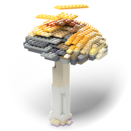

<p align="center"></p>

# Legolize it

Turns an STL or STEP part into a model of stud-and-tube bricks (the common 8 mm system): it voxelizes the part on the
brick grid, lays bricks so the layers interlock, shows the result with the input translucent over the opaque bricks,
and exports it to **FreeCAD** (a document with a solid per brick, grouped by layer) and as an **STL stack for 3D
printing** (one slab per layer that plugs into the next, or single bricks with a parts list).

The layout follows SHaPe ReCo's: an engine package (`lego_engine/`, like `reco_engine/`), a PyQt5 + VTK window
(`lego_gui/`, like `reco_gui/`), `install.sh` with a command and a desktop entry, `tests/`, and the logo pipeline in
`packaging/logo/`.

## Install

```bash
./install.sh            # environment ~/.local/share/legolize-it/venv (with the system's packages), the command
                        # legolize-it, the desktop entry "Legolize it" and its icon
legolize-it check       # packages, FreeCAD, one part into bricks with both exports
./install.sh --uninstall
```

Needs Python >= 3.10 with numpy, scipy, trimesh, libigl, manifold3d (and PyQt5, vtk for the window) -
`requirements*.txt`. FreeCAD's `freecadcmd` is used for STEP input and the FreeCAD export
(`$LEGOLIZE_FREECADCMD`, else `freecadcmd` on the PATH, else `/usr/bin/freecadcmd`).

## Use

**The window:** `legolize-it [part.stl|part.step]` (or `python3 -m lego_gui`). Open a part (or drop it on the window),
press *Legolize it* (F5).

- left: the settings - size (studs along the longest side, or a scale factor), layer height (brick 9.6 / plate 3.2 mm),
  up axis, fill threshold, shell, thin walls (auto / all / off), the brick catalogue, the brick system's dimensions,
  export options; after
  the first run every change redoes the bricks by itself (*Update live*);
- middle: the 3D view - the input translucent, the bricks opaque; colours by size / layer / mixed / from the input;
  the *Layers* slider builds the stack up layer by layer; bricks that are not connected to the bottom are magenta;
- right: the numbers, the parts list and the layers;
- toolbar: *Export STL stack*, *Export FreeCAD*, *Open in FreeCAD* (with the colour macro), the results folder.

**The command line:**

```bash
legolize-it cli part.step --studs 24 --unit plate --stl layers --fcstd --out out/
#   out/result.json    settings, placement, grid, every brick (layer, i, j, w, d), colours, numbers
#   out/stl/           the STL stack (layers/, bricks/, assembly.stl, parts.csv, manifest.json, README.txt)
#   out/part.FCStd     + part_colours.FCMacro
python3 -m lego_engine --help        # the same without the installed command
```

## How it works

1. **Placement** (`voxelize.place`): the part is turned so its up axis is +z, scaled (studs along the longest
   side, or a factor - the part's units are taken as mm), centred in x/y with its bottom on the grid's floor.
2. **Fill fraction** (`voxelize.fill_fraction`): each cell (pitch x pitch x layer height) is sampled on a regular
   sub-grid (3 x 3 x 3 by default); a point is inside when its generalized winding number is above 0.5 (libigl - robust
   for STLs with small holes). *Thin walls* (`surface_cells`, `thin_cells`): sheet metal, profiles and slim bars fill
   no cell to the threshold and fall between the sample points; *auto* (the default) adds the cells the surface passes
   where no filled cell is near (and the step that attaches them to their body) - a solid part does not change;
   *all* adds every cell the surface passes; *off*.
3. **Layout** (`layout.py`): per layer, the first free cell in scan order anchors the brick with the best score: area,
   + bridging two or three bricks below, + the layer's direction (layers cross), - ending on a joint of the layer below
   (running bond). Repair passes (`layout_connected`): where two groups touch side by side without holding together
   (a fin on a block, a joint of a frame), the layout is redone so a brick reaches across. The cover is exact
   (`check_cover`).
4. **Analysis** (`analysis.py`): bricks hold through studs only; a group that does not reach the bottom is floating
   (the largest group is the model itself and never floating).
5. **Exports**: printable manifold solids (manifold3d) for the STL stack; a FreeCAD document built by `freecadcmd`.

Colours from the input: a PLY/OBJ/GLB with vertex or face colours gives every brick the colour of the nearest surface,
snapped to a palette of brick colours (*Colours: from the input*).

## The logo

A Golden Teacher (*Psilocybe cubensis*): caramel umbo, golden cap, pale margin, dark gills, the white stem with its
spore-darkened ring - modelled in Blender, turned into bricks by Legolize it itself and rendered in Blender, not fully
built:

```bash
python3 packaging/logo/make_logo.py       # ~1.5 min: examples/golden_teacher.*, packaging/legolize-it.png, icons/
```

`packaging/logo/golden_teacher.py` (the model, Blender) -> `python3 -m lego_engine ... --colours source` (the bricks)
-> `packaging/logo/render_logo.py` (Cycles; the scene is saved as `packaging/logo/legolize-it_logo.blend`).

## Tests

```bash
python3 -m pytest tests -q          # ~2 s; the FreeCAD tests skip without freecadcmd
python3 scripts/check_parts.py <folder of parts> --sample 40 --stl --fcstd   # robustness over many parts
```

Tested on the [ABC dataset](https://deep-geometry.github.io/abc-dataset/) (chunk 0000, 2026-11-11), defaults
(16 studs, bricks, thin walls auto): 20 parts with both exports - among them a 0.1 mm sheet, a 1.2 m bar, a 48-solid
assembly, a 6 mm part, an invalid solid, a file with unbounded surfaces - and 40 random parts with the printable
slabs: all gave bricks, no errors, every slab watertight. 25 of the 40 needed thin walls; 12 of the 40 hold together
as one piece, the others are assemblies, single-layer flat parts or have detached bodies (the window shows which).

## Examples

- `examples/golden_teacher.ply` - the logo's mushroom with its colours (`.stl` without, `.blend` the Blender model);
- `examples/portal_frame.step` - a steel portal frame (6.35 x 4.39 m, IPE beams, thin walls): try `--studs 24`.

## Limits

- One layer height per model (bricks or plates), no slopes or round bricks.
- The layout is greedy: it removes most floating bricks, not all - thin overhangs (a mushroom cap's wavy margin) can
  stay floating; the window marks them.
- A flat part that becomes a single layer does not hold together (bricks side by side are not connected): plates or a
  bigger size give it more layers. Bodies of an assembly that do not touch stay separate.
- A STEP input with unbounded surfaces goes into the FreeCAD document as its tessellated mesh (the export says so).
- Colours and transparency in FreeCAD come from the macro next to the document (a console FreeCAD cannot set view
  properties).
