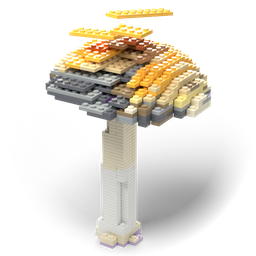
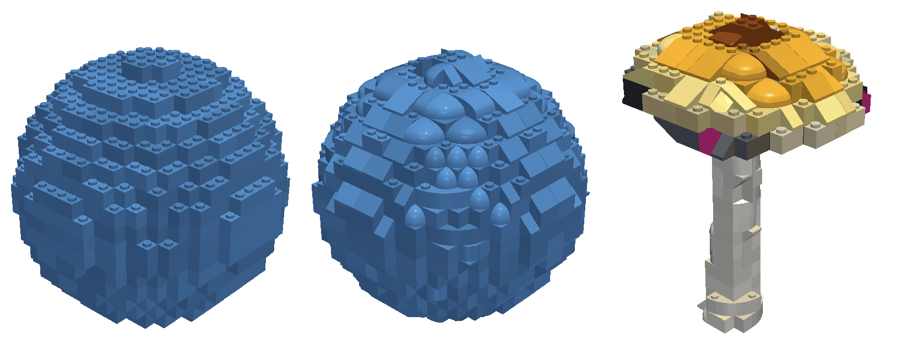
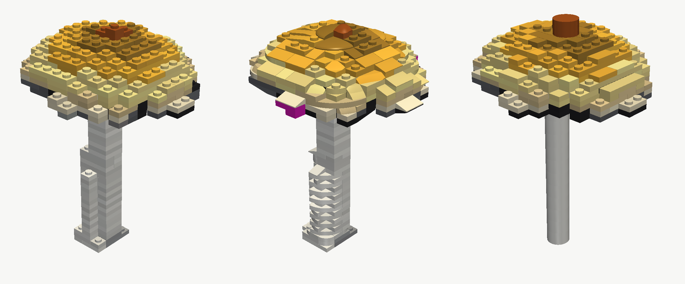
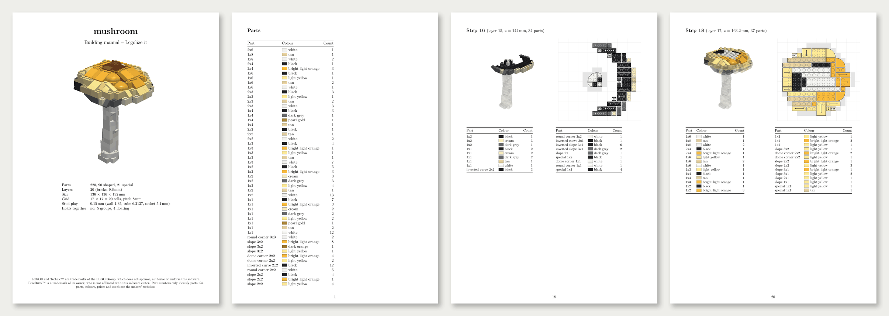
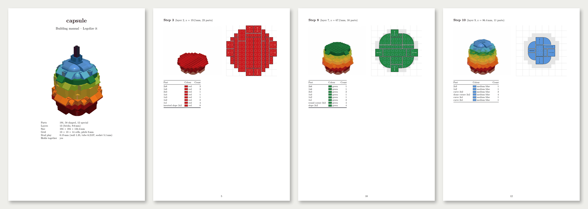

<p align="center"></p>

# Legolize it

Turns an STL or STEP part into a model of stud-and-tube bricks (the common 8 mm system): it voxelizes the part on the
brick grid, lays bricks so the layers interlock - with **shaped pieces** (slopes, curved slopes, round corners, round
bricks, dome corners, inverted ones) where the surface curves and **special pieces** (custom parts with the part's
exact shape) where nothing else fits - shows the result with the input translucent over the opaque bricks, and exports
it to **FreeCAD** (a coloured document, a solid per part, every stud fit sized from one tolerance and checked), as an
**STL stack for 3D printing** (one slab per layer that plugs into the next, or single parts with a parts list) and as
a **building manual** (LaTeX and PDF, one step per layer). It runs here or **on a server over ssh**.

Legolize it is not affiliated with, sponsored, authorised or endorsed by the LEGO Group or BlueBrixx - see
[TRADEMARKS.md](TRADEMARKS.md).

The layout follows SHaPe ReCo's: an engine package (`lego_engine/`, like `reco_engine/`), a PyQt5 + VTK window
(`lego_gui/`, like `reco_gui/`), `install.sh` with a command and a desktop entry, `tests/`, and the logo pipeline in
`packaging/logo/`.

## What it does

<p align="center"></p>

*Left: a sphere in plain bricks (20 studs, 7.8 % of its volume off). Middle: the same with shaped pieces - curved
slopes, dome corners, round corners, inverted slopes underneath (5.2 %). Right: the logo's mushroom (24 studs) with
shaped and special pieces in the colours of its PLY - the caramel umbo is a special piece; magenta marks parts that
are not connected to the bottom.*

1. **A part in.** STL, STEP, OBJ, PLY, 3MF or glTF. A coloured mesh keeps its colours; a plain one gets a pattern
   (by size, rainbow, fade, random, one colour ...).
2. **The resolution.** How many studs along the part's longest side, in bricks (9.6 mm) or plates (3.2 mm): a slider
   under the 3D view redoes the model as you move it, from a blocky likeness to a fine one.
3. **Bricks that hold.** The part is measured on the brick grid (winding numbers, robust for imperfect meshes), sheet
   metal and thin profiles are caught, and the bricks are laid in a running bond so the layers interlock; parts that
   would not hold are shown in magenta.
4. **Shaped pieces where the surface curves**, **special pieces where nothing else fits**: slopes, curved slopes,
   round corners, round bricks, dome corners and inverted ones go only where they match the part better than the
   bricks; special pieces carry the part's exact shape, to be printed. The window shows how far the model is from the
   part (its *deviation*).
5. **Three modes** (the window's *Mode*, see the picture below): *bricky* - plain bricks of the common sizes;
   *detailed* - shaped and special pieces, tiles on top, round rods, bars on clips; *artsy* - craftsmanship before
   accuracy: round bodies become parts threaded on **Technic™ axles** (round bricks and plates with an axle hole,
   gears, discs, rims), held by bricks with an axle hole or standing on studs; small detailed parts become printed
   pieces; mirror symmetry, no stray cells or colour specks, larger parts. The Technic parts are listed as bought in
   the parts list, the orders and the STL stack (`bought.csv`); the manual builds each axle stack first.
   **The catalogue** decides which single parts there are, whatever the mode: *Standard* (every part this program can
   lay, to print), *LEGO®* (the sizes and parts LEGO sells single) or *BlueBrixx™* (the brick and plate sizes of its part
   packs) - and in it any part can be switched off one by one: a size, a tile, a bar, a shaped piece, a gear, an axle.
6. **Parts that stack.** Every stud and what receives it - walls, tubes, posts, sockets - is sized from one
   tolerance, the stud play; the FreeCAD export measures stacked parts and finds no overlap and exactly that play.
7. **Out:** a coloured **FreeCAD** document (a solid per part, a spreadsheet of dimensions), an **STL stack** to
   print (a slab per layer that plugs into the next, or single parts), and a **building manual** (LaTeX and PDF,
   below). Heavy runs can go to a **server over ssh**.

<p align="center"></p>

*The mushroom at 20 studs in plates. Bricky: 303 plain bricks and plates (21 % of its volume off). Detailed: shaped
and printed pieces (15 % off; the magenta parts are not connected yet - more studs fix that). Artsy: the stem is a
stack of round bricks on a Technic axle, the cap bricks and tiles, the umbo a printed piece (41 % off - accuracy is
not what it optimises - and it holds). At 12 studs artsy mode builds the whole mushroom as one stack: round bricks,
round plates 6x6 and 4x4 on an axle 12L, no brick at all.*

### The building manual

One step per layer: a picture of the model so far (the new layer bright), the plan of the layer from above (the layer
below in grey, studs as circles, arrows down the fall of slopes - dashed when they fall underneath -, quarter circles
for round corners, hatched **S***n* for special pieces) and the parts of the step with their colours; in front, the
finished model, its numbers and the whole parts list.

<p align="center"></p>
<p align="center"></p>

Examples, made with the commands below:
[the mushroom](examples/manuals/golden_teacher_manual.pdf) (24 pages: 222 parts, 91 shaped, 21 special) and
[the capsule](examples/manuals/capsule_manual.pdf) (`examples/capsule.step`, 17 pages: 191 parts, rainbow colours).

```bash
legolize-it cli examples/golden_teacher.ply --studs 24 --shapes all --special --manual --out out/mushroom
legolize-it cli examples/capsule.step --studs 16 --shapes all --special --colours rainbow --manual --out out/capsule
```

In the window: *Export manual* (Ctrl+M), or tick *with every export* and the STL stack and FreeCAD exports bring it
along.

## Install

```bash
./install.sh            # environment ~/.local/share/legolize-it/venv (with the system's packages), the command
                        # legolize-it, the desktop entry "Legolize it" and its icon; run it again to update
                        # (after a git pull: the command runs this folder's code)
legolize-it check       # packages, FreeCAD, the desktop entry, one part into bricks with both exports and the same
                        # part in artsy mode
legolize-it uninstall   # the command, the desktop entry, the icons and the environment (= ./install.sh --uninstall);
                        # your results in ~/legolize_results stay
legolize-it uninstall --purge   # also the caches (~/.cache/legolize) and the server list (~/.config/legolize-it)
```

The desktop entry opens the window in the mode *Detailed*; right-click it in the applications menu or the dock for
*Legolize it - artsy mode* and *Legolize it - bricky mode* (the same as `legolize-it --artsy` and
`legolize-it --bricks-only`). It opens STL, STEP, PLY, OBJ, 3MF, glTF and OFF files.

Needs Python >= 3.10 with numpy, scipy, trimesh, libigl, manifold3d (and PyQt5, vtk for the window) -
`requirements*.txt`. FreeCAD's `freecadcmd` is used for STEP input and the FreeCAD export
(`$LEGOLIZE_FREECADCMD`, else `freecadcmd` on the PATH, else `/usr/bin/freecadcmd`).

## Use

**The window:** `legolize-it [part.stl|part.step]` (or `python3 -m lego_gui`; `--artsy` or `--bricks-only` start in
that mode). Open a part (or drop it on the window), press *Legolize it* (F5).

- left: the settings - the *Catalogue* (*Standard*, *LEGO* or *BlueBrixx*, with a link to the maker's website; *Parts
  ...* lists every part with a checkbox, greys out what is not in the range, and switches single parts off - the mode
  stays); the *Mode* on top sets the switches that make the look at once: *Bricky* (plain bricks of the
  common sizes), *Detailed* (shaped and printed pieces, tiles, rods, bars - the window's start) or *Artsy* (artsy
  mode, see below: axle stacks, printed details, symmetry, the larger sizes up to 12 long); a switch changed by hand
  shows *Custom*; the command line's `--bricks-only` and `--artsy` start in Bricky and Artsy; then size (studs along
  the longest side, or a scale factor), layer height (brick 9.6 / plate 3.2 mm),
  up axis, fill threshold, shell, thin walls (auto / all / off), the brick catalogue, *Pieces* (the shaped families and
  special pieces with their tolerance - on in the window, off on the command line unless asked), the brick system's
  dimensions with the *stud play*, export options and *Run exports on* (this computer or a server); after the first
  run every change redoes the bricks by itself (*Update live*);
- middle: the 3D view - the input translucent, the bricks opaque; colours *auto* (the input's colours when it has any,
  else by size), from the input, by size / layer, mixed, random, rainbow, fade (presets: sunset, ocean, forest, greys,
  candy, earth - snapped to brick colours), one colour; the *Layers* slider builds the stack up layer by layer; bricks
  that are not connected to the bottom are magenta; under the view the *Resolution* slider (coarse - fine: studs along
  the longest side, the model is redone as you move it, with its size in mm and its number of parts);
- right: the numbers (with the *deviation* from the part: the volume where model and part disagree, as a share of
  the part's volume), the parts list and the layers;
- toolbar (and the same buttons at the bottom of the settings' *Export* group): *Export STL stack*, *Export FreeCAD*
  (each with the building manual next to it, `manual/` or `<name>_manual/`, unless *with the building manual* is off),
  *Export manual* (Ctrl+M, the manual on its own), *Open in FreeCAD*, the results folder. An export clicked while the
  model is being redone waits for it and then runs.

**The command line:**

```bash
legolize-it cli part.step --studs 24 --unit plate --shapes all --special --stl layers --fcstd --manual --out out/
#   out/result.json    settings, placement, grid, every part (layer, i, j, w, d; kinds, turns), colours, numbers
#   out/stl/           the STL stack (layers/, bricks/ with piece_*.stl and special_*.stl, assembly.stl, parts.csv,
#                      manifest.json, README.txt)
#   out/part.FCStd     coloured; sheet "Dimensions"; + part_colours.FCMacro (the same colours, set from FreeCAD)
#   out/manual/        manual.tex, manual.pdf, img/
python3 -m lego_engine --help        # the same without the installed command
```

`--range standard|lego|bluebrixx` limits the sizes and parts to a maker's range, `--parts-off gear_24,tile_6x2,4x8`
switches single parts off, `--list-parts` lists every part's id and which ranges have it.
`--shapes` takes `slope, curve, round, dome, inverted`, `all` or `none` (the default); `--details` takes `tiles, rods,
bars`, `all` or `none` (the default) - parts for a set-like look, below; `--special [TOL]` adds special
pieces where the best brick or piece leaves more than TOL of a cell wrong (0.3); `--colours` auto (default), source,
size, layer, mixed, random, rainbow, fade (`--fade ocean`), single (`--single blue`); `--stud-play` the fit.

## Servers (ssh)

```bash
legolize-it server list                      # the hosts of ~/.ssh/config (aliases only) and the servers set up
legolize-it server add HOST ~/legolize_it --python ~/.local/share/legolize-it/venv/bin/python
legolize-it server sync HOST                 # copy this Legolize it (lego_engine, lego_gui) to that path
legolize-it server check HOST                # Python and packages there; FreeCAD, pdflatex
legolize-it cli part.step --server HOST --studs 48 --shapes all --fcstd --manual --out out/
```

In the window: *Export > Run exports on* and *Servers ...* (pick a host from the ssh config, give the path, check,
copy). The part goes to a fresh `mktemp -d` folder on the server, the run's progress comes back as it goes, the results
are fetched into the local folder and the work folder is removed. Only ssh's host aliases are read (ssh resolves host
names, users and keys itself; BatchMode, so a key or an agent is needed); the servers set up are kept in
`~/.config/legolize-it/servers.json` (mode 600), never in the repository or in results; the returned files are
rewritten to name the local input and folder, not the server's.

## Buying the parts (BlueBrixx)

```bash
# a snapshot of the shop's catalogue comes with Legolize it (lego_engine/data/, dated) - no crawl needed to price
legolize-it shop crawl                     # only for current prices and stock: ~700 requests, ~15 minutes
legolize-it cli part.ply --scale 1 --unit plate --cheapest --order de --manual --out out/
#   --cheapest   per colour the brick sizes whose order costs least - same grid, same cells
#                (--max-parts N keeps the count down; the sizes found: --colour-sizes 'white:2x4,1x2;red:1x2')
#   out/order/   order.tex, order.pdf, order.md, order.csv: one line per pack (item number, part, colour, packs)
legolize-it shop order Coaster=out1/result.json Brush=out2/manual/manual.tex --lang de --out order/   # one order
legolize-it shop plan plan.json --manual --out out/   # several builds in shared colours, bought together (below)
```

[BlueBrixx](https://www.bluebrixx.com) sells *part packs*: one part in one colour, e.g. "BRICK 2X4 X 50" for 4.95 EUR,
XL packs of 300-600 pieces for about 20 EUR. Every kind of part a model needs (size and colour) costs at least one
whole pack, so the bill depends on how many kinds there are much more than on how many bricks. `--cheapest` therefore
searches the brick sizes **per colour**: each colour starts with the sizes the shop sells in it (so the shop can fill
the order), then sizes are dropped from a colour while that lowers the price and the model holds together no worse -
an accent colour ends up with one or two sizes, the main colour keeps the big bricks. A model with a few more, smaller
bricks is often the cheaper one. Few colours, and hidden inner cells in a colour the model shows anyway, save more.

Builds bought together share packs, and they share more in the same colours: `--recolour 'white:light_bluish_grey,
dark_blue:dark_bluish_grey'` builds a model's colours in others, and `shop plan` takes several builds with their
colours as roles (0 light, 1 dark; colours not listed go by their lightness), tries colour pairs and searches the
sizes per colour over all builds at once - the
price of the one order, ties to the order whose packs are used most fully (the order list shows the usage per pack):

```json
{"pairs": [["light_bluish_grey", "dark_bluish_grey"], ["white", "black"]],
 "builds": [{"name": "Coaster", "input": "coaster.ply", "args": "--scale 1 --unit plate", "max_parts": 400,
             "roles": {"white": 0, "dark_blue": 1}}, ...]}
```

The catalogue comes with Legolize it: `lego_engine/data/bluebrixx_catalogue.json` (the standard brick and plate packs,
600 products, read on 2026-11-24), so pricing a build does not have to load the shop's servers again - please crawl
only when current prices or stock matter; your own crawl (`~/.cache/legolize/bluebrixx/catalogue.json`) is then used
instead. A crawl reads the listings of partpacks/bricks and partpacks/plates, then the head of each standard pack's
page (its colour is only there: `BPP<design>-<colour>`, and
whether it is in stock). One request a second; robots.txt allows these pages; an interrupted crawl resumes. Prices and
stock change - the order list prints the snapshot's date and links every pack. In 2026-11 all in-stock brick and
plate packs were marked *available exclusively online*: the list flags them (not in the stores). Shaped pieces and
special pieces are listed apart (no standard pack). Shipping to Germany 5.95 EUR, free from 99 EUR.

## How it works

1. **Placement** (`voxelize.place`): the part is turned so its up axis is +z, scaled (studs along the longest
   side, or a factor - the part's units are taken as mm), centred in x/y with its bottom on the grid's floor.
2. **Fill fraction** (`voxelize.fill_fraction`): each cell (pitch x pitch x layer height) is sampled on a regular
   sub-grid (3 x 3 x 3 by default); a point is inside when its generalized winding number is above 0.5 (libigl - robust
   for STLs with small holes). *Thin walls* (`surface_cells`, `thin_cells`): sheet metal, profiles and slim bars fill
   no cell to the threshold and fall between the sample points; *auto* (the default) adds the cells the surface passes
   where no filled cell is near (and the step that attaches them to their body) - a solid part does not change;
   *all* adds every cell the surface passes; *off*.
3. **Shaped and special pieces** (`shapes.py`, optional): the cells near the surface are measured finely (6 x 6 x 6
   points); a piece goes where it fits the part better than the bricks (or gap) it replaces - by at least 0.2 of a
   cell, and no cell of it worse - if nothing sits on a cell without a stud (a curved top) and it holds (on a stud
   below or under something above). Pieces that end up floating are replaced by bricks. Special pieces: cells where
   the best brick or piece leaves more than the tolerance wrong get the input cut to the cell (manifold3d for a closed
   mesh; exact B-rep in FreeCAD for a STEP), joined into rectangles per layer. Measured 2026-11-12, deviation from the
   part: sphere 12 studs 12.9 % (bricks) -> 8.8 % (shaped), 24 studs 6.3 -> 4.4 %; the logo's mushroom (24) 26 -> 19 %.
   **Details** (`details.py`, optional, `--details`; in the window: *Pieces > Details*): parts laid by rule, not
   fitted to the surface, so a model looks like a set rather than a stack of bricks. *Tiles*: plates with nothing on
   top become tiles of their size (1x1 ... 1x8, 2x2 ... 2x6; plate layers only - larger plates stay studded).
   *Rods*: free-standing 1x1 columns, three layers or more, become round 1x1 plates or bricks (posts, supports).
   *Bars*: a straight run of 4, 5 or 7 cells standing free in its layer (nothing beside, above or below its middle)
   whose ends hold becomes a bar 3L, 4L or 6L on two clip plates - one piece with a stud and a seat at each end only,
   laid before the bricks. Tiles and rods keep every brick's place, so the cover, the colours and how the model holds
   do not change (nothing sits on a tile). The manual draws tiles with an inner edge and no studs, a bar as a line
   between its two clips.
   **Artsy mode** (`artsy.py`, `--style artsy`; in the window: *Pieces > Style*): built with craft, not to the last
   cell. Round bodies (a colour, a separate part, or the whole, whose outline stays the same all round one of the grid
   axes) become parts threaded on a Technic axle (`technic.py`: round plates and bricks with axle hole, gears, discs,
   rims; `assembly.py`): bodies on one axle make one stack, its profile cut into runs filled with as few and as thick
   parts as fit, each part in the input's colour around it; a lying axle is held by a brick with an axle hole at each
   end (on posts if need be), an upright stack (round 2x2 / 4x4 / 6x6) sits on studs. Only where the body shows - a
   stem that runs on inside a cap stays bricks there. Small detailed parts (about a brick) become printed pieces;
   mirror planes are enforced where the part nearly has them (`--artsy-symmetry off`); stray cells, pinholes and
   one-cell colour specks go; one-cell staircases get corner cells so they hold; a display base goes under parts that
   stand apart (`artsy_base`); a repair loop adds posts until nothing floats. `technic_colours` limits the Technic
   parts to the colours a shop sells. The manual builds each stack as a sub-assembly first; STL and FreeCAD exports
   leave the bought Technic parts out (`stl/bought.csv`). The report (`stats["craft"]`) counts techniques, parts,
   part types, colour regions and visible studs; the deviation is shown, not optimised.
4. **Layout** (`layout.py`): per layer, the first free cell in scan order anchors the brick with the best score: area,
   + bridging two or three bricks below, + the layer's direction (layers cross), - ending on a joint of the layer below
   (running bond). Repair passes (`layout_connected`): where two groups touch side by side without holding together
   (a fin on a block, a joint of a frame), the layout is redone so a brick reaches across. The cover is exact
   (`check_cover`).
5. **Analysis** (`analysis.py`): parts hold through studs only - a lower part's stud cell under an upper part's seat
   cell; a group that does not reach the bottom is floating (the largest group is the model itself, never floating).
6. **Exports**: printable manifold solids (manifold3d) for the STL stack; a FreeCAD document built by `freecadcmd`,
   its colours written into the file afterwards; the building manual (LaTeX, TikZ plans, VTK pictures).

**The fit of a stud** is one number, the stud play (radial, 0.15 mm): walls (1.35), tubes (6.21), posts (2.90) and
sockets (5.10) are sized from it (`BrickSystem.fit`), and every part over a stud gets a socket. The FreeCAD export
stacks pairs of parts that sit on each other in the model and measures them with OpenCASCADE - common volume 0, the
gap around every stud = the play - and writes it all into the document's spreadsheet *Dimensions*.

**Colours in FreeCAD**: a console FreeCAD has no view objects, so the export writes `GuiDocument.xml` and FreeCAD
1.x's binary `ShapeAppearance` record per part into the saved file itself (byte for byte what FreeCAD writes, checked
against freecadcmd), plus ShapeColor for FreeCAD 0.2x and an isometric camera; the document opens coloured.

Colours from the input: a PLY/OBJ/GLB with vertex or face colours gives every brick the colour of the nearest surface,
snapped to a palette of brick colours (*Colours: from the input*).

## The logo

A Golden Teacher (*Psilocybe cubensis*): caramel umbo, golden cap, pale margin, dark gills, the white stem with its
spore-darkened ring - modelled in Blender, turned into bricks by Legolize it itself and rendered in Blender, not fully
built:

```bash
python3 packaging/logo/make_logo.py       # ~1.5 min: examples/golden_teacher.*, packaging/legolize-it.png, icons/
```

`packaging/logo/golden_teacher.py` (the model, Blender) -> `python3 -m lego_engine ... --colours source` (the bricks)
-> `packaging/logo/render_logo.py` (Cycles; the scene is saved as `packaging/logo/legolize-it_logo.blend`).

## Tests

```bash
python3 -m pytest tests -q          # ~9 s; the FreeCAD tests skip without freecadcmd (servers: a stand-in for ssh)
python3 scripts/check_parts.py <folder of parts> --sample 40 --stl --fcstd   # robustness over many parts
```

Tested on the [ABC dataset](https://deep-geometry.github.io/abc-dataset/) (chunk 0000, 2026-11-11), defaults
(16 studs, bricks, thin walls auto): 20 parts with both exports - among them a 0.1 mm sheet, a 1.2 m bar, a 48-solid
assembly, a 6 mm part, an invalid solid, a file with unbounded surfaces - and 40 random parts with the printable
slabs: all gave bricks, no errors, every slab watertight. 25 of the 40 needed thin walls; 12 of the 40 hold together
as one piece, the others are assemblies, single-layer flat parts or have detached bodies (the window shows which).

## Examples

- `examples/golden_teacher.ply` - the logo's mushroom with its colours (`.stl` without, `.blend` the Blender model);
- `examples/portal_frame.step` - a steel portal frame (6.35 x 4.39 m, IPE beams, thin walls): try `--studs 24`;
- `examples/capsule.step` - a cylinder with a torus ring, a dome and a cone (made in FreeCAD): shaped pieces and
  exact special pieces;
- `examples/manuals/` - the building manuals of the mushroom and the capsule (PDF).

## The makers' ranges, trademarks

The LEGO and BlueBrixx ranges in `lego_engine/catalogues.py` are kept to the facts this program needs - which brick
sizes and part types exist, and part numbers to identify them - with none of the makers' names, pictures, prices or
descriptions. For parts, colours, prices and stock see their websites:
[LEGO Pick a Brick](https://www.lego.com/pick-and-build/pick-a-brick) and [BlueBrixx](https://www.bluebrixx.com).
The LEGO range is the one read at Pick a Brick on 2026-11-24; BlueBrixx's comes from the part-pack catalogue (bricks
and plates only - its other parts are not in the data). Shaped pieces are this program's own shapes, to print.

LEGO® and Technic™ are trademarks of the LEGO Group, which does not sponsor, authorise or endorse this software.
BlueBrixx™ is a trademark of its owner, who is not affiliated with this software either (more in
[TRADEMARKS.md](TRADEMARKS.md)). The program carries this
notice (`catalogues.NOTICE`) wherever it shows or writes the names: the window's *About* (F1) and *Parts* dialog,
`legolize-it --help` and the command lines' help, the installer, the building manual's title page, the order lists,
the STL stack's README.txt and the FreeCAD document's comment.

## Limits

- One layer height per model (bricks or plates). Shaped pieces are one layer high and parametric (a curve in plate
  layers is a plate high); their names follow the common parts, their exact sizes are this program's.
- Special pieces are printed parts, not off-the-shelf bricks. For a mesh input that is not closed they are built from
  the fine samples (blocky); in FreeCAD they are meshes for mesh inputs, exact solids for STEP inputs.
- The colours inside the FreeCAD document are written in FreeCAD 1.x's own format (checked byte for byte), but
  opening it in the FreeCAD window is the user's check - this program never starts the FreeCAD GUI.
- The layout is greedy: it removes most floating bricks, not all - thin overhangs (a mushroom cap's wavy margin) can
  stay floating; the window marks them.
- A flat part that becomes a single layer does not hold together (bricks side by side are not connected): plates or a
  bigger size give it more layers. Bodies of an assembly that do not touch stay separate.
- A STEP input with unbounded surfaces goes into the FreeCAD document as its tessellated mesh (the export says so).
- Runs on servers need ssh with a key or an agent (BatchMode: no password prompts) and Legolize it on the server
  (`server sync` copies it; the packages it needs must be there).
